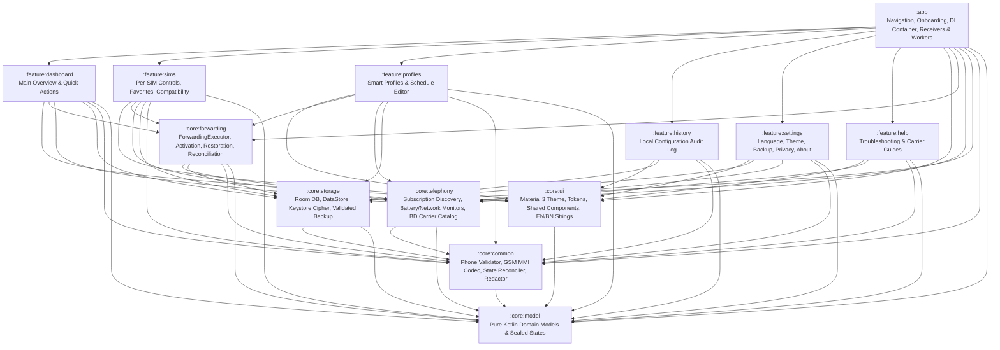

# Callora Architecture

## 1. Architectural Principles

Callora is a modular, offline-first Android application built with Kotlin, Jetpack Compose, Material 3, Coroutines/Flow, Room, DataStore, and WorkManager.

Three non-negotiable engineering invariants govern the architecture:

1. **Truthful Network State Separation:** Desired local profile state (`DesiredForwardingRule`) is strictly separated from carrier-side state (`ObservedForwardingStatus`). Launching a system dialer intent or submitting an MMI string **never** transitions carrier state to `NETWORK_STATE_VERIFIED` without authoritative evidence.
2. **Per-SIM Subscription Safety:** Domain models support `0..N` active subscriptions (Single-SIM, Dual-SIM, eSIM, Multi-Enabled Profiles). Subscriptions are tracked via a composite `SubscriptionIdentity` (`subscriptionId`, `simSlotIndex`, `mccMnc`, `isEmbedded`) so SIM swaps or slot changes never silently redirect calls on an unintended SIM.
3. **Zero Backend / Local-Only Privacy:** Callora does not declare `android.permission.INTERNET`. All profiles, favorite destinations, and configuration history remain on-device, protected from unintended cloud auto-backup (`allowBackup="false"`) and encrypted at rest where appropriate via Android Keystore (`AES/GCM/NoPadding`).

---

## 2. Module Graph

---

## 3. Desired Local Profile vs. Verified Carrier Network State

| Layer | Model | Meaning | Persistence |
|---|---|---|---|
| **User Intent** | `SmartProfile` / `BaselineSimConfig` | What the user wants Callora to help configure per SIM (e.g., `CFNRc -> +88017XXXXXXXX`). | Room + Keystore-encrypted destination |
| **Execution Attempt** | `ForwardingOperationState` | Live progress (`IDLE`, `AWAITING_CONFIRMATION`, `IN_PROGRESS`, `COMPLETED`). | ViewModel state + `ConfigurationHistoryEntry` |
| **Observed Network State** | `ObservedSimForwardingState` | Last known state per SIM & `ForwardingServiceType`, tagged with `ForwardingVerificationState`. | Room (explicitly invalidated on SIM change or stale timeout) |

### Verification State Machine

1. `UNKNOWN_NETWORK_STATE` — Initial state before any check. Never rendered as "Off" or "Active".
2. `DESIRED_LOCAL_ONLY` — User saved a profile locally without submitting any network command yet.
3. `OPERATION_IN_PROGRESS` — USSD request or system dialer handoff currently active.
4. `COMMAND_SUBMITTED` — System dialer opened with pre-filled MMI (`ACTION_DIAL`); OS does not report whether the user pressed Call or what the carrier answered.
5. `COMMAND_ACCEPTED_UNVERIFIED` — Carrier returned a generic USSD acknowledgement or user confirmed executing the dialer prompt, without authoritative service interrogation proof.
6. `NETWORK_STATE_VERIFIED` — Authoritative status response parsed from `TelephonyManager.createForSubscriptionId(subId).sendUssdRequest("*#62#", ...)` confirming active/inactive state and destination match.
7. `FAILED_OPERATION` — Carrier/OS returned an explicit error (`SEND_USSD_FAILED`, `USSD_ERROR_SERVICE_UNAVAIL`, invalid MMI, timeout).
8. `UNSUPPORTED_CAPABILITY` — Blocked by OS policy (e.g., Android 17 QPR2 `USSD_ERROR_NOT_ALLOWED`) or unverified carrier code; directs user to `ACTION_DIAL` or System Call Settings.

---

## 4. Dependency Injection Choice

Rather than introducing annotation-processing overhead and build-time fragility for a clean 13-module MVP, Callora uses **constructor-based manual Dependency Injection** via an explicit `AppContainer` interface in `:app` and `ViewModelProvider.Factory` helpers. Every repository, use case, and ViewModel accepts interfaces (`SubscriptionDataSource`, `ForwardingExecutor`, `CalloraStorage`, `Clock`), making unit and integration testing fast, deterministic, and reflection-free.
